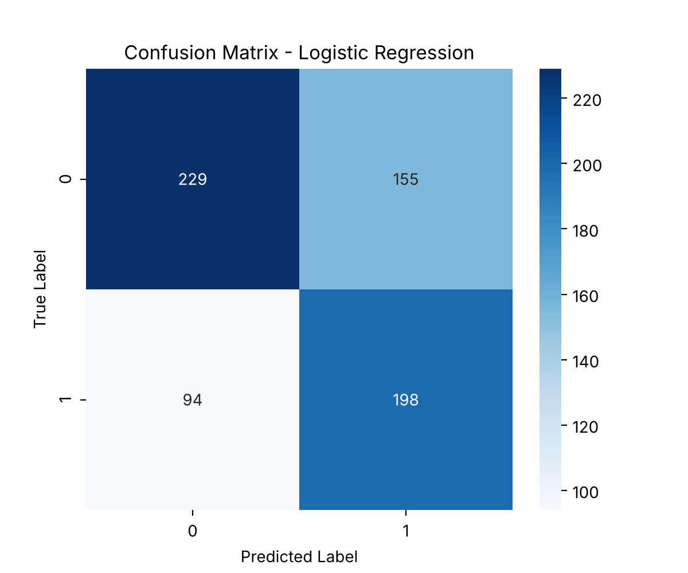
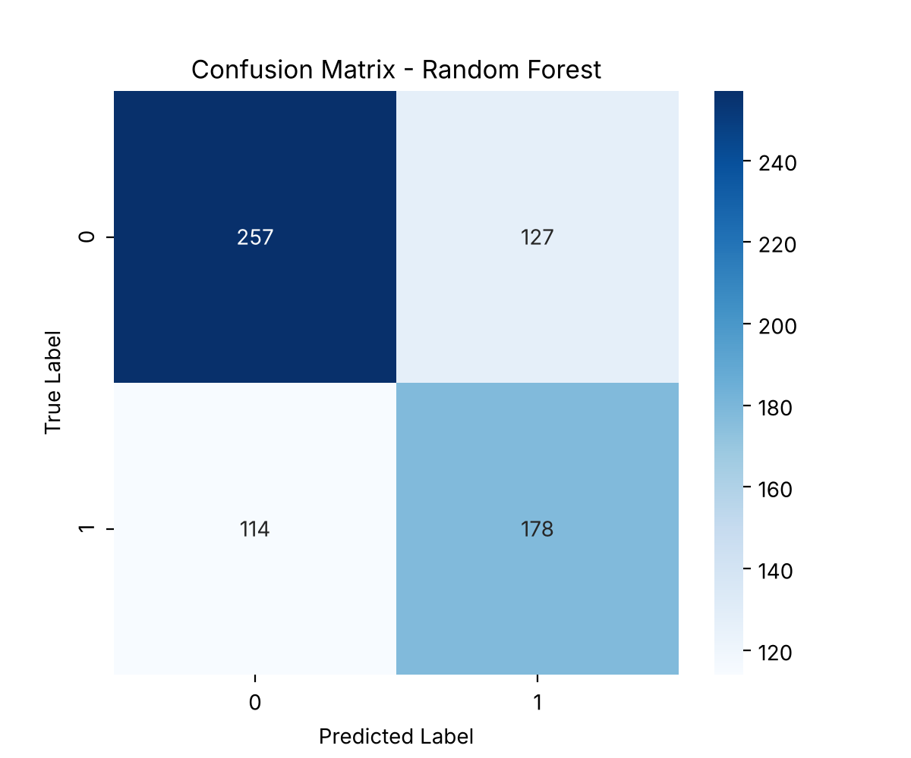
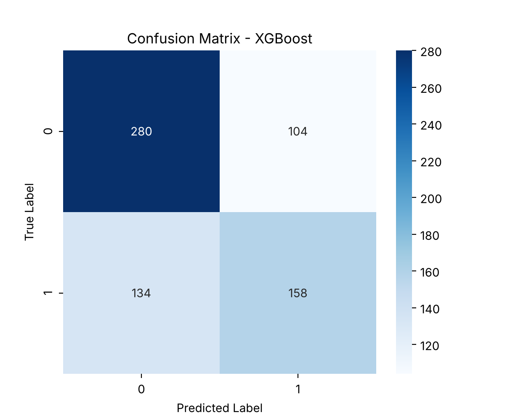
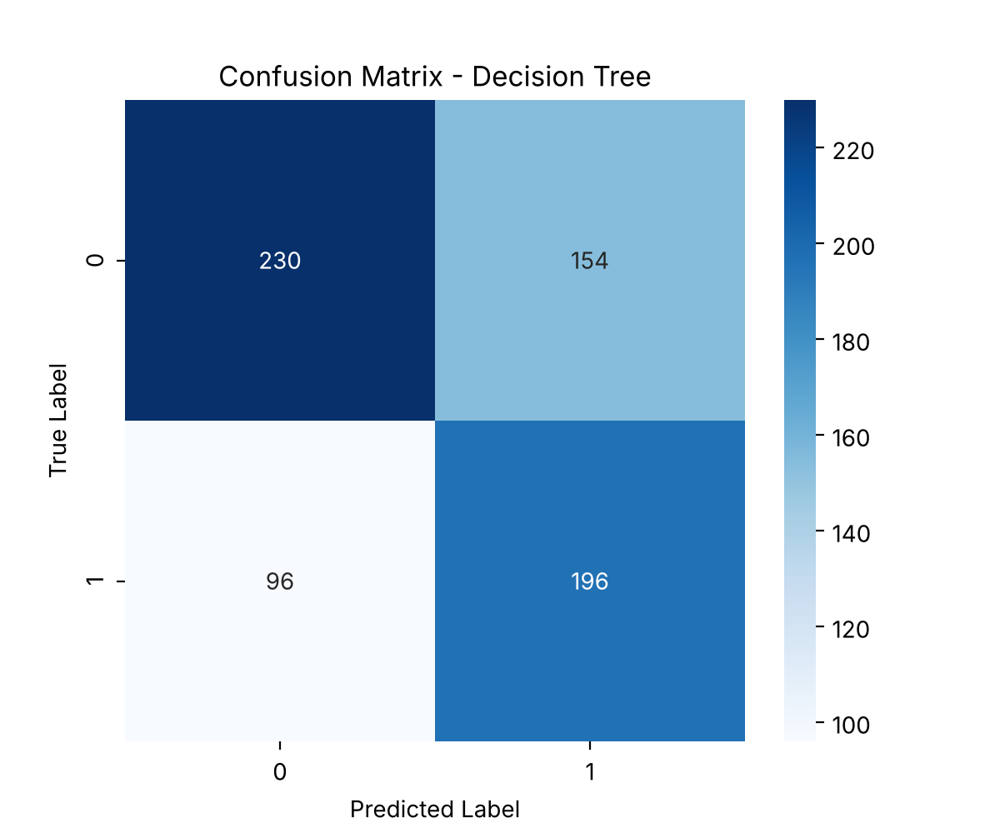
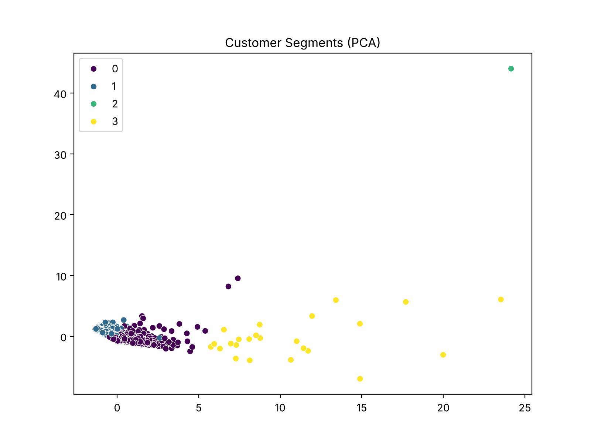

<div align="center">

```
██████╗ ███████╗     ██████╗ ██╗  ██╗ ██╗
██╔══██╗██╔════╝     ╚════██╗██║  ██║███║
██║  ██║███████╗█████╗█████╔╝███████║╚██║
██║  ██║╚════██║╚════╝╚═══██╗╚════██║ ██║
██████╔╝███████║     ██████╔╝     ██║ ██║
╚═════╝ ╚══════╝     ╚═════╝      ╚═╝ ╚═╝
```

### Customer Behaviour Analytics and Predictive Insights from E-Commerce Data

[](https://python.org)
[](https://scikit-learn.org)
[](https://xgboost.ai)
[](https://rasbt.github.io/mlxtend/)
[](https://flask.palletsprojects.com)

**DS-341 Data Mining · GIKI, Topi**

</div>

---

## Table of Contents

- [Overview](#overview)
- [Pipeline](#pipeline)
- [Churn Classification](#churn-classification)
- [Customer Segmentation](#customer-segmentation)
- [Market Basket Analysis](#market-basket-analysis)
- [Business Recommendations](#business-recommendations)
- [Dashboard](#dashboard)
- [Getting Started](#getting-started)
- [Challenges and Solutions](#challenges-and-solutions)

---

## Overview

An end-to-end data-mining study of the UCI **Online Retail** dataset (~540K raw transactions from a UK gift retailer, 2010 to 2011). The project applies the three core data-mining techniques from the course to one business question each:

| Technique | Business Question | Method |
|-----------|-------------------|--------|
| **Classification** | Which customers will stop buying in the next 90 days? | LogReg, Decision Tree, Random Forest, XGBoost |
| **Clustering** | What kinds of customers do we have? | K-Means (k=4) on RFM + AOV, visualised with PCA |
| **Association Rules** | Which products are bought together? | Apriori on the 50 best-selling products |

Results are served through a small Flask dashboard.

---

## Pipeline

```
┌──────────────────────────────────────────────────────────────────┐
│  data.csv  (UCI Online Retail, ~540K rows)                       │
└───────────────────────────────┬──────────────────────────────────┘
                                │
                                ▼
┌──────────────────────── src/data_processor.py ───────────────────┐
│  CLEAN                                                           │
│  ├── drop rows with no CustomerID                                │
│  ├── drop cancellations (Quantity <= 0) and UnitPrice <= 0       │
│  └── TotalPrice = Quantity x UnitPrice                           │
│                                                                  │
│  FEATURES (before cutoff)          LABEL (after cutoff)          │
│  ├── Recency, Frequency            cutoff = last date - 90 days  │
│  ├── Monetary, Tenure              Churn = 1 if no purchase      │
│  ├── AvgOrderValue                         in the next 90 days   │
│  └── UniqueProducts                                              │
└───────────────────────────────┬──────────────────────────────────┘
                                │
                                ▼
┌─────────────────────────── src/models.py ────────────────────────┐
│  ├── 4 classifiers, stratified 80/20 split ──► model_metrics.json│
│  ├── K-Means + PCA ──► cluster_summary.json, clusters_pca.png    │
│  └── Apriori ──► association_rules.json                          │
└───────────────────────────────┬──────────────────────────────────┘
                                │
                                ▼
┌────────────────────────────── app.py ────────────────────────────┐
│  Flask dashboard: overview · models · segments · recommendations │
└──────────────────────────────────────────────────────────────────┘
```

---

## Churn Classification

### Why the label matters

The first version of this project defined churn as `Recency > 90 days` and then also used Recency as an input. Every model scored a perfect 1.0, because the answer was one of the features. The current version fixes this:

```
    first purchase                    cutoff                 last date
         │                              │                        │
         ├──── features computed here ──┼──── 90-day window ─────┤
                                        │  bought again?  no = 1 │
```

### Results (held-out 20%, stratified, churn rate 43%)

| Model | Accuracy | Precision | Recall | F1 | ROC-AUC |
|-------|---------:|----------:|-------:|---:|--------:|
| **Logistic Regression** | 0.632 | 0.561 | **0.678** | **0.614** | **0.713** |
| Random Forest | 0.643 | 0.584 | 0.610 | 0.596 | 0.711 |
| XGBoost | **0.648** | **0.603** | 0.541 | 0.570 | 0.706 |
| Decision Tree (depth 6) | 0.630 | 0.560 | 0.671 | 0.611 | 0.672 |

Logistic Regression matching the tree ensembles suggests the signal is mostly linear in recency and frequency. An AUC around 0.71 is realistic for behavioural churn from six RFM-style features.

<details>
<summary><b>Confusion matrices</b></summary>

| Logistic Regression | Random Forest |
|:---:|:---:|
|  |  |
| **XGBoost** | **Decision Tree** |
|  |  |

</details>

---

## Customer Segmentation

K-Means (k=4) on standardised Recency, Frequency, Monetary and Average Order Value.

| Cluster | Profile | Recency (days) | Orders | Spend (GBP) | Avg. Order (GBP) |
|---------|---------|---------------:|-------:|------------:|-----------------:|
| 3 | **Loyal high-value** | 7 | 49.2 | 53,103 | 1,614 |
| 0 | **Active regulars** | 44 | 4.2 | 1,654 | 392 |
| 1 | **Lapsing one-timers** | 188 | 1.5 | 468 | 323 |
| 2 | **Single bulk buyers** (outliers) | 236 | 1.0 | 77,184 | 77,184 |

<div align="center">



</div>

---

## Market Basket Analysis

Apriori over invoices containing the 50 best-selling products (min support 3%, ranked by lift).

| If a basket contains | It likely also contains | Support | Confidence | Lift |
|----------------------|-------------------------|--------:|-----------:|-----:|
| Alarm Clock Bakelike Red | Alarm Clock Bakelike Green | 3.9% | 60% | **10.4x** |
| Alarm Clock Bakelike Green | Alarm Clock Bakelike Red | 3.9% | 67% | **10.4x** |
| Wooden Frame Antique White | Wooden Picture Frame White Finish | 3.4% | 58% | **8.9x** |
| Wooden Picture Frame White Finish | Wooden Frame Antique White | 3.4% | 53% | **8.9x** |

Customers buy colour variants and matching decor in sets, which points to bundle pricing rather than single-item promotion.

---

## Business Recommendations

| Segment / Finding | Action |
|-------------------|--------|
| Loyal high-value (Cluster 3) | Dedicated account manager, early access to new ranges |
| Active regulars (Cluster 0) | Bundle offers built from the top association rules |
| Lapsing one-timers (Cluster 1) | Time-limited win-back coupon, triggered by the churn model |
| High-lift product pairs | Sell as colour or style sets; show "complete the set" at checkout |

---

## Dashboard

| Route | Page |
|-------|------|
| `/` | Overview: customers, churn rate, revenue stats |
| `/models` | Model comparison table and confusion matrices |
| `/segments` | Cluster profiles and PCA plot |
| `/recommendations` | Association rules and actions |
| `/api/metrics`, `/api/clusters`, `/api/rules`, `/api/stats` | JSON endpoints behind the pages |

---

## Getting Started

```bash
pip install -r requirements.txt

# Data (not committed): download "Online Retail" from
# https://archive.ics.uci.edu/dataset/352/online+retail
# export to CSV and save as data.csv in the project root

python src/data_processor.py   # clean + features + leak-free labels
python src/models.py           # classification, clustering, association rules
python app.py                  # http://localhost:5000
```

Full methodology and discussion: [REPORT.md](REPORT.md)

---

## Challenges and Solutions

| Challenge | Solution |
|-----------|----------|
| Perfect 1.0 scores from label leakage (churn defined by a feature) | Cutoff-based labelling: features before, outcome after |
| ~25% of rows had no CustomerID | Dropped; they cannot be targeted, so they add no business value |
| Cancelled orders appear as negative quantities | Removed before computing spend |
| Apriori on 4,000+ products ran out of memory | Restricted the basket matrix to the 50 best-selling products |
| Churners and non-churners not perfectly balanced | Stratified split, class-weighted models, F1 and ROC-AUC reported alongside accuracy |

---

## Contributors

**Abdul Rehman Faisal** · BS Data Science, GIKI (2027)
[GitHub](https://github.com/ARFaisal-Rehman) · [LinkedIn](https://linkedin.com/in/abdul-rehman-faisal-2a680b297)

---

<div align="center">

**DS-341 Data Mining · GIKI · Data: UCI Machine Learning Repository**

</div>
