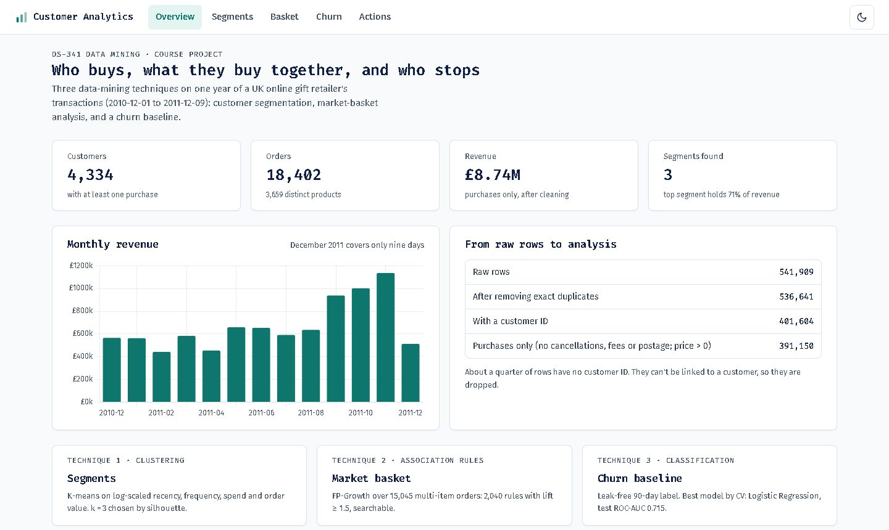
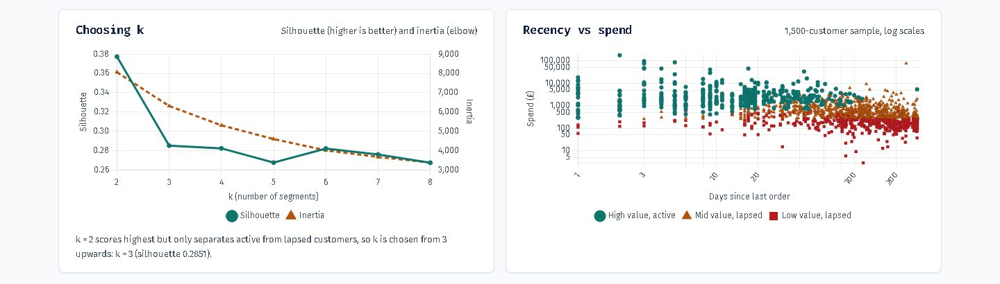
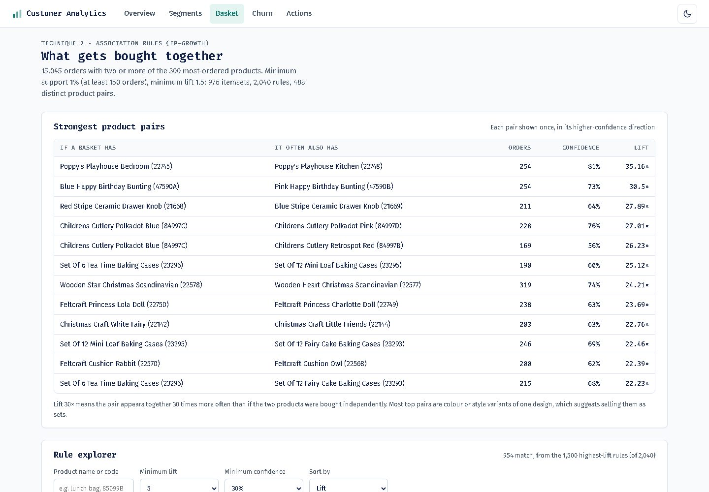

<div align="center">

```
██████╗ ███████╗     ██████╗ ██╗  ██╗ ██╗
██╔══██╗██╔════╝     ╚════██╗██║  ██║███║
██║  ██║███████╗█████╗█████╔╝███████║╚██║
██║  ██║╚════██║╚════╝╚═══██╗╚════██║ ██║
██████╔╝███████║     ██████╔╝     ██║ ██║
╚═════╝ ╚══════╝     ╚═════╝      ╚═╝ ╚═╝
```

### Customer Segmentation and Market-Basket Analysis on E-Commerce Transactions

[](https://python.org)
[](https://scikit-learn.org)
[](https://rasbt.github.io/mlxtend/)
[](https://flask.palletsprojects.com)
[](tests/test_analysis.py)

**DS-341 Data Mining · GIKI, Topi**



</div>

---

## Table of Contents

- [Overview](#overview)
- [What changed in the November 2026 revision](#what-changed-in-the-november-2026-revision)
- [Pipeline](#pipeline)
- [Customer Segmentation](#customer-segmentation)
- [Market Basket Analysis](#market-basket-analysis)
- [Churn Baseline](#churn-baseline)
- [Business Recommendations](#business-recommendations)
- [Getting Started](#getting-started)
- [Challenges and Solutions](#challenges-and-solutions)
- [Contributors](#contributors)

---

## Overview

A data-mining study of the UCI **Online Retail** dataset (541,909 raw rows from a UK gift retailer, Dec 2010 to Dec 2011). Each of the three core course techniques answers one business question:

| Technique | Business question | Method |
|---|---|---|
| **Clustering** (headline) | What kinds of customers do we have? | K-means on log-scaled RFM + order value, k chosen by silhouette |
| **Association rules** (headline) | Which products are bought together? | FP-Growth over the 300 most-ordered products, with a searchable rule explorer |
| **Classification** (baseline) | Who stops buying in the next 90 days? | Four classifiers on a leak-free label, chosen by cross-validation |

Churn is treated as a baseline here. The same problem is taken much further in my [Risk Radar](https://github.com/ARFaisal-Rehman/Churn-Predictor) project (two years of data, out-of-time testing, calibration).

## What changed in the November 2026 revision

| Before | After |
|---|---|
| K-means k=4 on raw, skewed values, giving clusters of **1** and about **6** customers | Log-scaled features, k from 3 to 8 chosen by silhouette: 3 segments of 862 to 1,366 customers |
| Segment names written by hand | Names generated from fixed rules on each segment's medians, so they can't contradict the numbers |
| Apriori on the top 50 products, top 10 rules by lift (5 of them mirror images of the other 5) | FP-Growth on the top 300 products: 2,040 rules, 483 distinct pairs, each pair listed once |
| Static results page | Rule explorer: search by product, filter by lift and confidence |
| Best model picked on the test set | Best model picked by 5-fold CV on the training split; test scored once |
| Duplicates, postage and fee codes left in | Removed (rows at each step reported) |
| No tests | 5 pytest tests, including rule metrics recomputed by hand from raw baskets |

## Pipeline

```
┌──────────────────────────────────────────────────────────────────┐
│  data.csv  (UCI Online Retail, 541,909 rows; not committed)      │
└───────────────────────────────┬──────────────────────────────────┘
                                ▼
┌──────────────────────── src/data_processor.py ───────────────────┐
│  CLEAN  duplicates · no CustomerID · cancellations · price <= 0  │
│         postage, fees and manual adjustments  ─► 391,150 rows    │
│  RFM    Recency, Frequency, Monetary, Tenure, AOV, UniqueProducts│
│  LABEL  cutoff = last date - 90 days; Churn = no purchase after  │
└───────────────────────────────┬──────────────────────────────────┘
                                ▼
┌─────────────────────────── src/models.py ────────────────────────┐
│  segment_customers  log + standardise ─► K-means, k by silhouette│
│  market_basket      invoice x product ─► FP-Growth ─► rules      │
│  churn_baseline     LogReg | Tree | RF | XGBoost, 5-fold CV      │
└───────────────────────────────┬──────────────────────────────────┘
                                ▼
          run_pipeline.py ─► results/{overview,segments,basket,churn}.json
                                ▼
┌────────────────────────────── app.py ────────────────────────────┐
│  Overview · Segments · Basket (rule explorer) · Churn · Actions  │
└──────────────────────────────────────────────────────────────────┘
```

## Customer Segmentation

The 3,368 customers who bought before the churn cutoff (2011-09-11), clustered with K-means on log-transformed, standardised Recency, Frequency, Monetary and Average Order Value. Silhouette for k = 2..8: 0.377, **0.285**, 0.282, 0.268, 0.282, 0.276, 0.267. k = 2 only separates active from lapsed customers, so k is chosen from 3 upwards (k = 3).

| Segment | Customers | Share of revenue | Median days since order | Median orders | Median spend | Churned in next 90 days |
|---|---|---|---|---|---|---|
| High value, active | 862 (26%) | **71%** | 16 | 6 | £2,136 | 15% |
| Mid value, lapsed | 1,366 (41%) | 24% | 94 | 2 | £651 | 47% |
| Low value, lapsed | 1,140 (34%) | 4% | 128 | 1 | £189 | 60% |

Naming rule: value = segment median spend vs the median customer (over 2x high, under 0.5x low); status = median days since last order (30 or fewer active, 90 or fewer cooling, more lapsed). The churn column is an outcome the clustering never saw, and it lines up with the segments.



## Market Basket Analysis

FP-Growth over the 15,045 orders that contain at least two of the 300 most-ordered products. Minimum support 1% (150 orders), minimum lift 1.5: 976 frequent itemsets, 2,040 rules, 483 distinct product pairs.

| If a basket has | it often also has | Orders | Confidence | Lift |
|---|---|---|---|---|
| Poppy's Playhouse Bedroom | Poppy's Playhouse Kitchen | 254 | 81% | **35.2x** |
| Blue Happy Birthday Bunting | Pink Happy Birthday Bunting | 254 | 73% | 30.5x |
| Red Stripe Ceramic Drawer Knob | Blue Stripe Ceramic Drawer Knob | 211 | 64% | 27.9x |
| Childrens Cutlery Polkadot Blue | Childrens Cutlery Polkadot Pink | 228 | 76% | 27.0x |
| Set of 6 Tea Time Baking Cases | Set of 12 Mini Loaf Baking Cases | 190 | 60% | 25.1x |

Most top pairs are colour or style variants of one design, which points to selling them as sets. 461 rules have confidence of 50% or more, enough for "complete the set" prompts.



## Churn Baseline

3,368 customers who bought before 2011-09-11; 43.0% made no purchase in the following 90 days. Five-fold CV on the 80% training split picks the model; the 20% test split is scored once.

| Model | CV ROC-AUC | Test ROC-AUC | F1 |
|---|---|---|---|
| **Logistic Regression** (selected) | **0.751 ± 0.018** | 0.715 | 0.611 |
| Random Forest | 0.746 | 0.720 | 0.624 |
| XGBoost | 0.742 | 0.714 | 0.597 |
| Decision Tree | 0.731 | 0.695 | 0.583 |

**Why the first version scored 1.0:** churn was defined as Recency over 90 days, and Recency was also a feature. Features now come from before the cutoff and the label from after it.

## Business Recommendations

| Segment or finding | Action | Evidence |
|---|---|---|
| High value, active | Protect with account management; avoid blanket discounts | 71% of revenue, only 15% churned |
| Mid value, lapsed | Time-limited win-back built around past purchases | Largest group (41%), 24% of revenue, 47% churned |
| Low value, lapsed | Email only; paid outreach doesn't pay | 4% of revenue |
| High-lift product pairs | Sell as sets; "complete the set" at checkout | Lift 25x to 35x on the top pairs |

These are hypotheses for a controlled test, not measured effects.

## Getting Started

```bash
pip install -r requirements.txt

# Data (not committed): download "Online Retail" from
# https://archive.ics.uci.edu/dataset/352/online+retail
# export the sheet to CSV and save it as data.csv in the project root

python run_pipeline.py        # about 15 seconds; writes results/*.json
python app.py                 # http://localhost:5001
python -m pytest              # synthetic data, no download needed
```

`results/*.json` is committed, so the dashboard runs without the dataset. Full course write-up: [REPORT.md](REPORT.md).

## Challenges and Solutions

| Challenge | Solution |
|---|---|
| Perfect 1.0 scores from label leakage | Cutoff-based labelling: features before, outcome after |
| One customer with a single £77k order became its own cluster | Log transform before scaling; k by silhouette |
| Ranking rules by lift listed every pair twice (A to B and B to A) | Pairs de-duplicated, keeping the higher-confidence direction |
| Apriori on the full catalogue ran out of memory | FP-Growth on the 300 most-ordered products |
| Test product codes "B" and "D" vanished in the tests | They are real fee codes in this dataset (bad-debt adjustment, discount); the cleaning is right and the test now uses its own codes |
| About 25% of rows have no CustomerID | Dropped; they can't be linked to a customer |

## Contributors

**Abdul Rehman Faisal** · BS Data Science, GIKI (2027)
[GitHub](https://github.com/ARFaisal-Rehman) · [LinkedIn](https://linkedin.com/in/abdul-rehman-faisal-2a680b297)

---

<div align="center">

**DS-341 Data Mining · GIKI · Data: UCI Machine Learning Repository (CC BY 4.0)**

</div>
